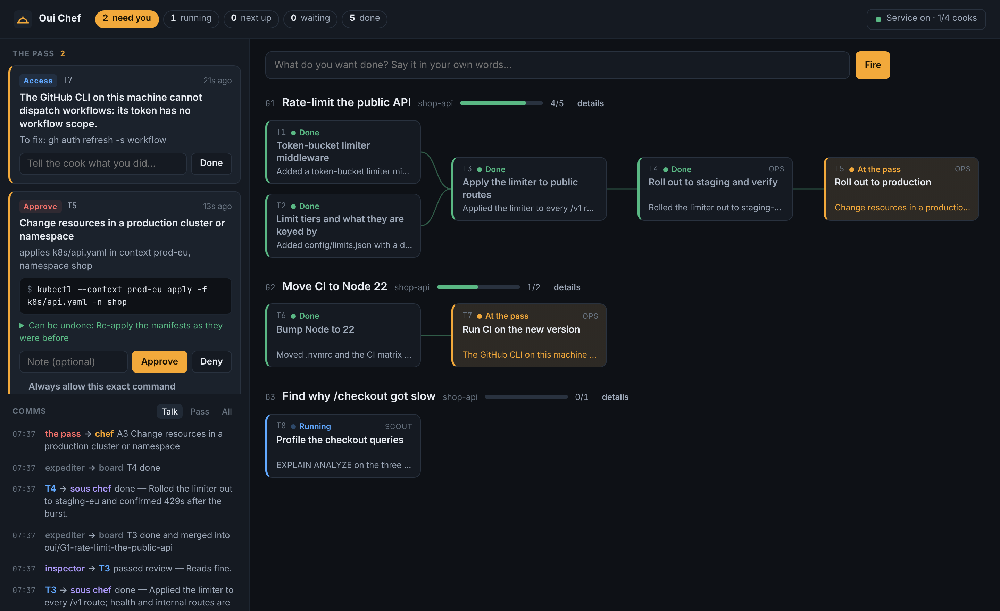

# Oui Chef

An orchestrator for coding agents, run like a kitchen. You give the order. A sous chef breaks it into tickets with an order of their own, cooks carry them out at their stations, and you are interrupted only for what is yours to decide. One board shows what is waiting on you, what is cooking and what comes next.



In a serious kitchen the chef does not cook during service. The chef stands at **the pass**: the counter every plate crosses on its way out. Orders are called from there, each station gets on with its part, and nothing leaves until the chef has seen it. Oui Chef gives you that seat for your coding agents.

- **You do not keep track of sessions.** Every ticket, in every project, is on one board. The top of it is the only list you need to read: *the pass*.
- **Order is part of the plan.** Tickets say what they need. Each one is fired when what it needs is finished, and the board shows that order left to right.
- **Cooks run their own commands.** They use git, gh, kubectl, helm, cloud CLIs and pipelines themselves. They never ask you to run something and paste the output. When they lack access they tell you exactly what to grant, once.
- **Risky is held, reversible is recorded.** Every command crosses the pass before it runs. Most go straight through. Changes to shared systems go through and are recorded with a recipe to undo them. Merging, production, deleting what cannot be recreated and publishing wait there for your approval.
- **Small contexts.** A cook sees its ticket, the goal in your words and a few lines from the tickets it builds on. The sous chef reads a digest, never a transcript. State lives on disk, so any conversation can be closed and nothing is lost.

## The kitchen

```
you ── goal ─▶ sous chef ── tickets, with needs ─▶ expediter ─▶ cook, one per ticket
 ▲                                                    │              │
 │                                                    │    every tool call
 └──── the pass: questions · access · approvals ◀─────┴──────────────┘
                                                      │
                                      inspector checks finished work,
                                      expediter merges it, you land the goal
```

| | What it is | What it does |
|---|---|---|
| **Chef** | You | Give goals, answer what only you can, approve what is risky |
| **Sous chef** | A model, called for short judgement calls | Turns a goal into tickets; answers cooks' questions the goal already settles and passes the rest up, reworded |
| **Inspector** | A model, read-only | Checks each finished build ticket against its brief before it merges |
| **Cook** | One headless Claude Code session per ticket, at its own station (a git worktree) | Does the work, commits, reports |
| **Expediter** | Plain code, no model | Fires tickets in order, delivers answers, runs checks, merges, lands |
| **The pass** | Plain code, a hook on every tool call | Lets it through, records it with an undo, holds it for you, or refuses |

Everything mechanical is code. A model is used only where judgement is needed, each time from a few paragraphs, ending in one command.

## Install

Needs Node 20 or newer, git, and [Claude Code](https://code.claude.com) logged in (`claude` on your PATH). `gh`, `kubectl` and the rest are used when your tickets need them.

```bash
git clone https://github.com/alakiani/oui.git
cd oui
npm link        # puts `oui` on your PATH
npm test        # 33 tests; takes about 15 seconds
```

There are no dependencies to install.

## A first service, without touching anything real

```bash
oui demo
```

This starts a throwaway kitchen: a scratch repository, stand-in cooks that follow a script, and a fake `kubectl` and `gh` that only print. Open the address it prints. Within a few seconds a cook's question arrives at the pass; answer it and watch the tickets behind it fire, until a production rollout is held for your approval.

## Using it

```bash
oui up                                   # start the kitchen; prints the board's address
oui project add ~/code/api               # register a repository
oui go "Add rate limiting to the public API and roll it out to staging"
```

`oui go` hands the goal to the sous chef, who reads the repository, writes the tickets and their order, and puts into the first ticket that needs it anything only you can provide. Cooks start as soon as the plan is in.

To talk a goal through first, with you in the loop:

```bash
oui sous                                 # an interactive Claude Code session that knows how to plan
```

Then decide, from the board or the terminal:

```bash
oui status                               # what is on the pass, and where everything stands
oui answer A3 "Per API key"              # or: oui answer A3   (shows the ask and prompts)
oui approve A5 --note "window is open"   # let a held command through
oui deny A5 --note "not before Monday"
oui approve A5 --always                  # and never hold this exact command again
```

And look closer when you want to:

```bash
oui tail T4 -f                           # a cook's activity
oui takeover T4                          # step into its conversation; the pass stays in place
oui log                                  # who said what to whom
oui actions                              # everything changed outside a station, with its undo
oui undo X12                             # show the recipe;  --yes runs it
```

`oui help` lists the rest.

### What a ticket goes through

`waiting` (something it needs is unfinished) → `next up` → `running` → `in review` (your project's checks, then the inspector) → merged into the goal's branch → `done`. On the way it can be `at the pass` (an open question, access request or held command), `with sous chef` (a question the sous chef may be able to answer), or sent back to its cook with the reason.

Finished tickets merge into one branch per goal, so later tickets start from everything before them. When a goal is finished you get one ask: land it. Landing is a fast-forward of your base branch (`landing: local`) or one pull request (`landing: pr`). A plan can also contain a `land` ticket in the middle, for work that must be on the base branch before a pipeline or rollout runs.

### Plans

A plan is a goal and tickets with `needs`. The sous chef writes them; you can too:

```bash
oui plan - <<'EOF'
{ "goal": { "title": "Rate-limit the public API", "detail": "…", "project": "api" },
  "tickets": [
    { "key": "limiter", "title": "Token-bucket middleware", "brief": "…", "accept": ["unit tests cover refill and 429"] },
    { "key": "wire",    "title": "Apply it to /v1 routes", "needs": ["limiter"], "brief": "…" },
    { "key": "land",    "kind": "land", "title": "Land before deploying", "needs": ["wire"] },
    { "key": "rollout", "kind": "ops",  "title": "Deploy to staging and verify", "needs": ["land"], "brief": "…" }
  ] }
EOF
```

`kind` is `build` (changes code), `ops` (acts on clusters, pipelines, deploys), `scout` (investigates and reports) or `land`.

### Kitchen calls

The plain words work everywhere. So do the kitchen's:

| You say | It means |
|---|---|
| `oui fire "<goal>"` | `oui go`: hand over a goal |
| `oui refire T4` | `oui retry T4`: send a ticket back to its cook |
| `oui 86 T4` | `oui cancel T4`: take a ticket off the board |
| `oui service off` | nothing new is fired; turns in progress finish |

## The pass

Every tool call a cook makes crosses the pass before it runs. For shell commands it reads the command the way a careful person would: through pipes, `&&`, `$(…)`, `bash -c`, `sudo`, `xargs` and `ssh host '…'`.

| Tier | What happens | Examples |
|---|---|---|
| **run** | Goes through. Not recorded. | tests, builds, `git commit`, `kubectl get`, `terraform plan`, anything inside the cook's station |
| **run + undo** | Goes through. Recorded in the ledger, with a checkpoint and the commands that put it back wherever one exists. | `git push` of a ticket branch, `kubectl apply` on staging, `helm upgrade` outside production, `gh workflow run ci.yml`, a write to a non-production database, a connected tool (MCP) that is not plainly read-only |
| **hold** | Stops at the pass. You get an ask with the command and its undo. On approval the cook is resumed and runs exactly that. | `gh pr merge`, anything in a production context or namespace, `kubectl delete namespace`, `terraform apply`, `npm publish`, `DROP TABLE`, `rm -rf` or any write outside the station, `curl … \| sh`, `make deploy` |
| **never** | Refused. | reading the chef's token, calling the chef's commands, talking to the daemon directly, changing the agent's own identity |

Before a recorded command runs, the pass saves what it is about to change: the live manifests for `kubectl apply`, the replica count for `kubectl scale`, the release revision for `helm upgrade`, the remote commit for `git push`. `oui undo` turns that into commands.

```bash
oui policy rules                          # every rule, its tier, and what it means
oui policy set forge.pr.merge record      # e.g. let cooks merge pull requests, recorded with an undo
oui policy set kube.change hold           # or be asked even for staging
```

`~/.ouichef/policy.json` holds your overrides, what counts as production (`prod.words`, `prod.contexts`, `prod.namespaces`, `prod.hosts`), which clusters are always scratch space (`safe.contexts`), your protected branches, and `allow` / `hold` / `deny` patterns for whole commands.

**What the pass is not.** It is a seatbelt, not a sandbox. It catches what an eager agent does in plain sight, and it is tested against a long list of real commands. It cannot see inside a script it has not read, and an agent determined to hide what it does from the same user account could. It holds scripts whose names say deploy, release, migrate or destroy for that reason. Some undo recipes are honest about their limits: a deleted volume's data does not come back, a published package stays published, a cancelled pipeline does not undo what it already did.

## The board in Herdr

```bash
oui mod install       # copies the mod to ~/.config/herdr-app/mods/ouichef
```

Then, in [Herdr](https://herdr.dev):

```bash
herdr-app check ~/.config/herdr-app/mods/ouichef
herdr-app do pane.split --direction right --mod ouichef
```

The mod is a 360px panel: the pass on top with its buttons, then running, next up, waiting, done and the latest messages. Its header button opens a tab with every goal as a lane and connectors for what waits on what. See [`herdr/ouichef/RECIPE.md`](herdr/ouichef/RECIPE.md).

The mod has not been run inside Herdr yet; see "What was and was not verified" below. If `herdr-app check` reports a problem, give the agent in Herdr the recipe: it lists the five places a difference is most likely.

The same board is always available in a browser at the address `oui up` prints.

## Configuration

`~/.ouichef/config.json` (all optional):

| Key | Default | Meaning |
|---|---|---|
| `port` | `7330` | Where the daemon listens, on 127.0.0.1 only |
| `maxCooks` | `3` | Cooks running at once, across all projects |
| `model`, `sousModel` | harness default | Model for cooks, and for the sous chef's and inspector's short calls |
| `calls.plan` / `calls.triage` / `calls.review` | `true` | Turn each judgement call off |
| `maxAttempts` | `3` | Times a ticket is sent back before you are asked |
| `turnTimeoutMinutes` | `120` | A cook's turn longer than this is stopped |
| `budgetUsdPerTurn` | none | Spending limit per cook turn |

Per project (`oui project add <path> --landing local|pr --merge ask|auto --verify "npm test"`): how goals land, whether landing asks you, and checks every ticket must pass.

`oui remember "always squash-merge"` saves a standing preference. Every cook and every plan gets it.

Set `OUI_HOME` to keep a second, separate kitchen.

## What was and was not verified

Verified, with real runs:

- **The whole loop with real Claude Code agents**, on a scratch repository: a cook edited and committed, was held at the pass on a production `kubectl apply`, ended its turn, was resumed after approval, ran the command and reported; an inspector reviewed the diff read-only and passed it; the work was merged and landed. A real sous chef planned a one-sentence goal into ordered tickets.
- **33 automated tests**: the dependency graph; the pass against about 200 commands and tool calls; every prompt rendered with nothing left blank; and the full loop with scripted cooks through the real hooks, CLI and git, including denial, a cook trying to approve itself, a cook that goes silent, failed checks, mid-plan landing, undo, and the daemon's access rules.
- **The web board** in Chromium: dark, light and phone width; answering, approving and firing a goal from the page.

Not verified:

- **The Herdr mod inside Herdr.** Herdr was not available where this was built. The mod uses only calls the Agenttrail mod uses, and its logic and actions are tested against a live daemon with Herdr's modules replaced by stand-ins. How Herdr draws it is unconfirmed.
- **Real clusters and forges.** `kubectl`, `helm` and `gh` were stand-ins. The checkpoint and undo commands are the documented ones; they have not been run against a live cluster.
- **`landing: pr`** (push and `gh pr create`), **`oui sous`** and **`oui takeover`** (interactive sessions) were not exercised end to end.
- **Other agent CLIs.** Cooks are Claude Code. `src/harness/` is the one place to add another.

## Layout

```
bin/oui.mjs                the command
src/kitchen.mjs            all state and the rules for changing it
src/expediter.mjs          fires, supervises, reviews, merges, lands
src/guard/                 the pass: the command reader, the rules, checkpoints and undo
src/harness/               Claude Code as cook; a scripted stand-in for tests and the demo
src/server.mjs             the loopback API
src/board.mjs              the snapshot both boards draw
prompts/                   what cooks, the sous chef and the inspector are told
web/index.html             the board in a browser
herdr/ouichef/             the Herdr mod and its recipe
test/                      npm test
```

State is in `~/.ouichef`: `state.json`, `events.jsonl` (who said what), `ledger.jsonl` (what was changed, with undo), `tickets/<id>/` (brief, report, activity, checkpoints).

## Credits

The idea of one agent you talk to and workers it runs for you, and of waking a supervisor only when something needs it, comes from [firstmate](https://github.com/kunchenguid/firstmate). "Decisions, not supervision", asks that end a turn, and standing preferences come from [obeya](https://github.com/sadilek/obeya). The mod's structure follows [Agenttrail's](https://github.com/sodiumsun/agenttrail). The pass, the undo ledger, the dependency-ordered expediter and landing per goal are this project's own.

Oui Chef is not affiliated with any restaurant, guide or chef.

## License

MIT. See [LICENSE](LICENSE).
